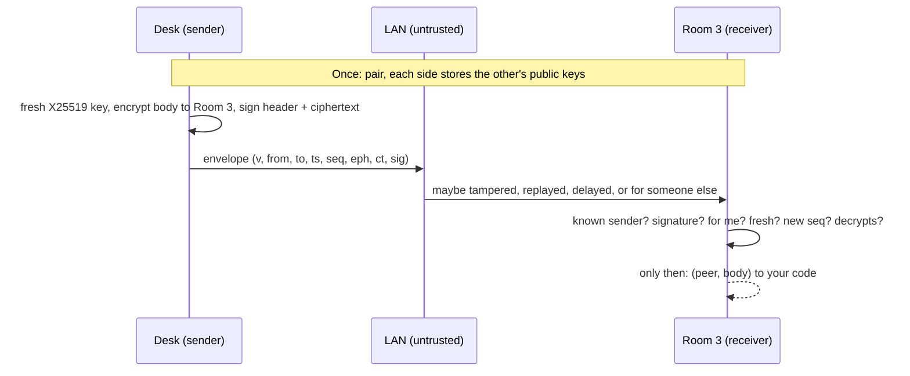

<p align="center">
  
</p>

<p align="center">
  <a href="https://github.com/TonyD365/lanpair/actions/workflows/ci.yml"></a>
  <a href="https://github.com/TonyD365/lanpair/actions/workflows/security.yml"></a>
  <a href="https://scorecard.dev/viewer/?uri=github.com/TonyD365/lanpair"></a>
  
  
  <a href="https://github.com/TonyD365/lanpair/blob/main/LICENSE"></a>
</p>

<p align="center">
  <b>Secure device pairing and messaging for the local network, in a few lines of Python.</b>
</p>

---

You have a desk PC and ten room PCs. Or a Raspberry Pi and a phone. Or a game host and its
controllers. They sit on the same Wi-Fi, and you want one to send commands to the other.

The usual answer is an HTTP endpoint or a UDP broadcast with **no authentication at all**:
anyone on the network can read the traffic, send "unlock" themselves, or record a command
and play it back tomorrow. Doing it properly means TLS certificates, key exchange, nonce
handling and replay windows: a week of security work for a side feature.

**lanpair** is that week of work, packaged. Devices pair once, then every message is
encrypted to its recipient, signed by its sender and checked for replay before your code
ever sees it.

> **Status: 1.x, stable API.** Identity, encrypted envelopes, replay protection, key
> storage and discovery are done, tested and fuzzed, and follow semantic versioning.
> Pairing flows (QR, 6-digit code) and the `Host` / `Device` API are still to come and will
> be added without breaking changes. There has been no external security review yet.

## Contents

- [Quick look](#quick-look)
- [What you get](#what-you-get)
- [How it works](#how-it-works)
- [Where it's going](#where-its-going)
- [Compared with alternatives](#compared-with-alternatives)
- [Install](#install)
- [Contributing](#contributing)

## Quick look

The building blocks available today. You choose the transport (UDP, TCP, WebSocket,
anything that carries bytes); lanpair makes the bytes safe.

```python
from lanpair import Identity, JsonFileSeqStore, Opener, Sealer

desk, room3 = Identity.generate(), Identity.generate()  # one per device, keep the seed

# Pairing: each side stores the other's public identity (64 bytes, fits in a QR code).
# The store remembers what was already received, so replays fail even after a restart.
inbox = Opener(room3, store=JsonFileSeqStore("room3-seqs.json"))
inbox.add_peer(desk.public)

# The desk sends...
wire = Sealer(desk).seal(room3.public, {"type": "close", "reason": "checkout"})

# ...and room 3 receives. Anything forged, tampered, replayed, stale or meant for
# another device raises EnvelopeError instead.
peer, body = inbox.open(wire)
assert peer == desk.public and body["type"] == "close"
```

Without a store, `Opener` keeps its memory in RAM and, to stay replay-safe, refuses
messages for the first 30 seconds after it starts.

To keep a device's keys across restarts, store them in the operating system's key store
(macOS Keychain, Windows Credential Manager, Secret Service on Linux) instead of a file:

```python
# pip install "lanpair[keyring]"
from lanpair import load_or_create_identity

me = load_or_create_identity()  # generated on first run, the same one afterwards
```

Find paired devices on the network by id, so changing IP addresses don't matter:

```python
# pip install "lanpair[discovery]"
from lanpair.discovery import Announcer, find

with Announcer(me.public, "Room 3", port=8765):  # on the device
    ...

room3 = find(room3_id)  # on the desk: FoundDevice(..., address="192.168.1.23:8765") or None
```

Discovery is only a hint about addresses; it never decides who is trusted.

What an eavesdropper sees on the network: who is talking to whom and how much, nothing
more.

```json
{"ct":"m1Zq…","eph":"ZJ8v…","from":"4f1c0a9e7b2d1c33","seq":1763683200123456,
 "sig":"Gx0k…","to":"a87e5512c0de9b41","ts":1763683200.12,"v":2}
```

## What you get

| Attack from someone on your LAN | What lanpair does |
|---|---|
| Reads your messages | Bodies are encrypted to the recipient (X25519 + ChaCha20-Poly1305) |
| Sends fake commands | Every message is signed (Ed25519); unknown or unpaired senders are dropped |
| Changes a message in flight | Signature and AEAD tag both fail |
| Redirects a message to another device | The recipient is signed in, and only it holds the decryption key |
| Records a message and replays it | Increasing sequence numbers, checked per peer |
| Replays after you restart the app | Sequence numbers survive restarts (time-based sender, persistent or start-window receiver) |
| Replays an old message much later | Timestamps outside ±30 s are refused |
| Sends junk to crash your parser | Strict validation; everything becomes `EnvelopeError` |

Also: fully typed (mypy strict), one dependency ([`cryptography`](https://cryptography.io)),
tested on Linux, macOS and Windows with Python 3.10 to 3.13.

## How it works



One 32-byte seed per device gives both its Ed25519 signing key and its X25519 encryption
key. The full threat model, the reasoning behind each layer, and the known limits are in
[docs/design.md](https://github.com/TonyD365/lanpair/blob/main/docs/design.md).

## Where it's going

The goal is a two-object API where you never touch keys:

```python
# Host, e.g. a front desk            # Device, e.g. a room PC
from lanpair import Host             from lanpair import Device

host = Host("Desk")                  dev = Device("Room 3")
print(host.pairing_qr())             dev.pair(scanned_code)      # once
host.send("room-3", {"type": "close"})
                                     for msg in dev.messages():  # already verified
                                         handle(msg)
```

| Piece | State |
|---|---|
| Identity, signed + encrypted envelopes | ✅ done |
| Replay protection across restarts | ✅ done |
| Keys in the OS key store (Keychain, Credential Manager, Secret Service) | ✅ done |
| mDNS / zeroconf discovery | 🔜 |
| Keys in the OS key store (Keychain, Credential Manager, Secret Service) | 🔜 next |
| mDNS / zeroconf discovery | ✅ done |
| QR code pairing | 🔜 |
| 6-digit code pairing with a PAKE | 🔜 |
| `Host` / `Device` API | 🔜 |
| Published on PyPI | ✅ 1.0.0 |

Want to help with one of these? See the [open issues](https://github.com/TonyD365/lanpair/issues).

## Compared with alternatives

| | lanpair | Plain HTTP / UDP | Self-managed TLS | Noise / libsodium directly |
|---|---|---|---|---|
| Authenticated messages | ✅ | ❌ | ✅ | ✅ |
| Encrypted | ✅ | ❌ | ✅ | ✅ |
| Replay protection | ✅ built in | ❌ | per connection | you build it |
| Pairing flow (QR / code) | 🔜 built in | ❌ | you build a CA | you build it |
| Lines of code for you | a few | a few | many | many |

## Install

```bash
pip install lanpair
```

## Contributing

Bug reports, ideas and pull requests are welcome. Start with
[CONTRIBUTING.md](https://github.com/TonyD365/lanpair/blob/main/CONTRIBUTING.md). Found a security issue? Please report it privately as
described in [SECURITY.md](https://github.com/TonyD365/lanpair/blob/main/SECURITY.md), not in a public issue.

```bash
git clone https://github.com/TonyD365/lanpair && cd lanpair
pip install -e ".[dev]"
pytest && ruff check . && mypy src
```

## License

[MIT](https://github.com/TonyD365/lanpair/blob/main/LICENSE)
