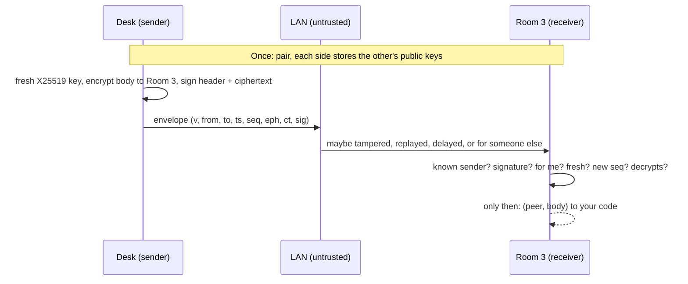

<p align="center">
  
</p>

<p align="center">
  <a href="https://github.com/TonyD365/lanpair/actions/workflows/ci.yml"></a>
  <a href="https://github.com/TonyD365/lanpair/actions/workflows/security.yml"></a>
  <a href="https://scorecard.dev/viewer/?uri=github.com/TonyD365/lanpair"></a>
  <a href="https://www.bestpractices.dev/projects/16988"></a>
  <a href="https://pypi.org/project/lanpair/"></a>
  <a href="https://pypi.org/project/lanpair/"></a>
  
  <a href="https://github.com/TonyD365/lanpair/blob/main/LICENSE"></a>
</p>

<p align="center">
  <b>Secure device pairing and messaging for the local network, in a few lines of Python.</b>
  <br>
  <a href="https://tonyd365.github.io/lanpair/">Website</a> ·
  <a href="https://github.com/TonyD365/lanpair/wiki">Docs</a> ·
  <a href="https://pypi.org/project/lanpair/">PyPI</a>
</p>

<p align="center">
  
</p>

---

You have a desk PC and ten room PCs. Or a Raspberry Pi and a phone. Or a game host and its
controllers. They sit on the same Wi-Fi, and you want one to send commands to the other.

The usual answer is an HTTP endpoint or a UDP broadcast with **no authentication at all**:
anyone on the network can read the traffic, send "unlock" themselves, or record a command
and play it back tomorrow. Doing it properly means TLS certificates, key exchange, nonce
handling and replay windows: a week of security work for a side feature.

**lanpair** is that week of work, packaged. Devices pair once, then every message is
encrypted to its recipient, signed by its sender and checked for replay before your code
ever sees it.

> **Status: 1.x, stable API** under semantic versioning. Tested on Linux, macOS and
> Windows, property-tested and fuzzed. There has been no external security review yet,
> including of the new 6-digit code pairing.

## Contents

- [Quick look](#quick-look)
- [What you get](#what-you-get)
- [How it works](#how-it-works)
- [Where it's going](#where-its-going)
- [Compared with alternatives](#compared-with-alternatives)
- [Install](#install)
- [Contributing](#contributing)

## Quick look

```bash
pip install "lanpair[all]"
```

```python
# host.py: a front desk, a hub
from lanpair import Host

with Host("Front desk") as host:
    if not host.devices:  # first run: show a QR code and wait for a device
        host.pairing_offer().print_qr()
        host.wait_for_pairing(timeout=300)
    for msg in host.messages():  # every message is already verified
        print(msg.sender.name, msg.body)
        host.send(msg.sender.device_id, {"type": "ok"})
```

```python
# device.py: a room PC, a Raspberry Pi
from lanpair import Device

with Device("Room 3") as dev:
    if dev.host is None:  # first run: pair with the scanned QR code
        dev.pair(input("Scanned code: "))
    dev.send({"type": "checkout"})
    for msg in dev.messages():
        print(msg.body)
```

That is the whole setup: pairing happens once, and both sides remember each other across
restarts. Behind it:

- **Pairing by QR code.** The code carries the host's keys and a one-time secret. The
  device proves it scanned the code; nobody on the network can join or impersonate the
  host. One device per code, 5 minutes, 5 tries.
- **Keys in the OS key store**, peers and replay counters on disk, so pairing survives
  restarts and old messages stay rejected.
- **Discovery with mDNS**, so changing IP addresses don't matter.
- **Any size up to 1 MiB**: small messages go by UDP, larger ones over TCP, automatically.
- **Every message** encrypted, signed, bound to its recipient and replay-checked before
  `messages()` hands it to you.

### Try it from the terminal

No code needed: run one command on each machine.

```bash
lanpair host                 # machine 1: shows a pairing code and a QR code
lanpair join 'lanpair://…'   # machine 2: the code from machine 1, once
```

Both then print what arrives, and each line you type is sent, signed and encrypted.
`lanpair send "text"` sends one message from a paired device and exits (add `--json` for
JSON), and `lanpair devices` and `lanpair forget NAME` list and unpair devices.

### When a message must arrive

```python
host.send(device_id, {"type": "close"}, ack=True)  # retries; raises DeliveryError if not confirmed
state = host.request(device_id, {"type": "status"})  # waits for the device's reply
results = host.broadcast({"type": "closing"}, ack=True)  # {device_id: True or False}

msg = dev.receive()
dev.reply(msg, {"state": "open"})  # answers a request
```

### No camera? Pair with a 6-digit code

```python
offer = host.pairing_offer()
print(offer.code)  # on the host: "482913"
dev.pair_with_code("482913")  # on the device: finds the host with mDNS
```

The code keys CPace, a PAKE: someone on the network can test at most one guess per try,
and the host allows 5 tries, so the chance of guessing is 1 in 200,000. It works once and
for 5 minutes, like the QR code.

Retried messages are delivered once. For asyncio, use `AsyncHost` and `AsyncDevice`, with the
same methods. To check a pairing by eye, pass `confirm=` to `pairing_offer()` and `pair()`:
both sides get the same short code, and pairing stops unless your function returns True.

### Lower level: bring your own transport

The building blocks under `Host` and `Device`. You choose the transport (TCP, WebSocket,
anything that carries bytes); lanpair makes the bytes safe.

```python
from lanpair import Identity, JsonFileSeqStore, Opener, Sealer

desk, room3 = Identity.generate(), Identity.generate()  # one per device, keep the seed

# Pairing: each side stores the other's public identity (64 bytes, fits in a QR code).
# The store remembers what was already received, so replays fail even after a restart.
inbox = Opener(room3, store=JsonFileSeqStore("room3-seqs.json"))
inbox.add_peer(desk.public)

# The desk sends...
wire = Sealer(desk).seal(room3.public, {"type": "close", "reason": "checkout"})

# ...and room 3 receives. Anything forged, tampered, replayed, stale or meant for
# another device raises EnvelopeError instead.
peer, body = inbox.open(wire)
assert peer == desk.public and body["type"] == "close"
```

Without a store, `Opener` keeps its memory in RAM and, to stay replay-safe, refuses
messages for the first 30 seconds after it starts.

To keep a device's keys across restarts, store them in the operating system's key store
(macOS Keychain, Windows Credential Manager, Secret Service on Linux) instead of a file:

```python
# pip install "lanpair[keyring]"
from lanpair import load_or_create_identity

me = load_or_create_identity()  # generated on first run, the same one afterwards
```

Find paired devices on the network by id, so changing IP addresses don't matter:

```python
# pip install "lanpair[discovery]"
from lanpair.discovery import Announcer, find

with Announcer(me.public, "Room 3", port=8765):  # on the device
    ...

room3 = find(room3_id)  # on the desk: FoundDevice(..., address="192.168.1.23:8765") or None
```

Discovery is only a hint about addresses; it never decides who is trusted.

What an eavesdropper sees on the network: who is talking to whom and how much, nothing
more.

```json
{"ct":"m1Zq…","eph":"ZJ8v…","from":"4f1c0a9e7b2d1c33","seq":1763683200123456,
 "sig":"Gx0k…","to":"a87e5512c0de9b41","ts":1763683200.12,"v":2}
```

## What you get

| Attack from someone on your LAN | What lanpair does |
|---|---|
| Reads your messages | Bodies are encrypted to the recipient (X25519 + ChaCha20-Poly1305) |
| Sends fake commands | Every message is signed (Ed25519); unknown or unpaired senders are dropped |
| Changes a message in flight | Signature and AEAD tag both fail |
| Redirects a message to another device | The recipient is signed in, and only it holds the decryption key |
| Records a message and replays it | Increasing sequence numbers, checked per peer |
| Replays after you restart the app | Sequence numbers survive restarts (time-based sender, persistent or start-window receiver) |
| Replays an old message much later | Timestamps outside ±30 s are refused |
| Sends junk to crash your parser | Strict validation; everything becomes `EnvelopeError` |
| Steals a device's keys later and decrypts what it recorded | Forward secrecy: `Host` / `Device` use session keys that live only in memory and change every 10 minutes |
| Sends huge or deeply nested packets | Size limit (1 MiB by default) and nesting checks before any parsing work |

Also: fully typed (mypy strict), one required dependency
([`cryptography`](https://cryptography.io)), tested on Linux, macOS and Windows with
Python 3.10 to 3.15, property-tested with Hypothesis, and fuzzed with Atheris on every
change. Releases are also checked in a simulated LAN ([`e2e/`](https://github.com/TonyD365/lanpair/tree/main/e2e)) with an attacker
node that sniffs, replays, tampers, redirects and forges traffic.

## How it works



One 32-byte seed per device gives both its Ed25519 signing key and its X25519 encryption
key. The full threat model, the reasoning behind each layer, and the known limits are in
[docs/design.md](https://github.com/TonyD365/lanpair/blob/main/docs/design.md).

## Where it's going

| Piece | State |
|---|---|
| Identity, signed + encrypted envelopes | ✅ 1.0 |
| Replay protection across restarts | ✅ 1.0 |
| Keys in the OS key store (Keychain, Credential Manager, Secret Service) | ✅ 1.0 |
| mDNS / zeroconf discovery | ✅ 1.0 |
| QR code pairing | ✅ 1.1 |
| `Host` / `Device` API | ✅ 1.1 |
| TCP for large messages (up to 1 MiB) | ✅ 1.2 |
| Forward secrecy with rotating session keys | ✅ 1.3 |
| Confirmed delivery, request/reply, broadcast | ✅ 1.4 |
| asyncio API (`AsyncHost`, `AsyncDevice`) | ✅ 1.4 |
| Optional short-code pairing check | ✅ 1.4 |
| 6-digit code pairing with a PAKE (CPace) | ✅ 1.5 |

Want to help with one of these? See the [open issues](https://github.com/TonyD365/lanpair/issues).

## Compared with alternatives

| | lanpair | Plain HTTP / UDP | Self-managed TLS | Noise / libsodium directly |
|---|---|---|---|---|
| Authenticated messages | ✅ | ❌ | ✅ | ✅ |
| Encrypted | ✅ | ❌ | ✅ | ✅ |
| Replay protection | ✅ built in | ❌ | per connection | you build it |
| Pairing flow (QR code) | ✅ built in | ❌ | you build a CA | you build it |
| Lines of code for you | a few | a few | many | many |

## Install

```bash
pip install lanpair                        # core: identities and secure envelopes
pip install "lanpair[keyring]"             # + keys in the OS key store
pip install "lanpair[discovery]"           # + mDNS discovery
pip install "lanpair[qr]"                  # + QR codes for pairing
pip install "lanpair[all]"                 # everything
```

Python 3.10 or newer. lanpair follows [semantic versioning](https://semver.org): no
breaking changes within 1.x.

## Contributing

Bug reports, ideas and pull requests are welcome. Start with
[CONTRIBUTING.md](https://github.com/TonyD365/lanpair/blob/main/CONTRIBUTING.md). Found a security issue? Please report it privately as
described in [SECURITY.md](https://github.com/TonyD365/lanpair/blob/main/SECURITY.md), not in a public issue.

```bash
git clone https://github.com/TonyD365/lanpair && cd lanpair
pip install -e ".[dev]"
pytest && ruff check . && ruff format --check . && mypy src
```

## License

[MIT](https://github.com/TonyD365/lanpair/blob/main/LICENSE)
